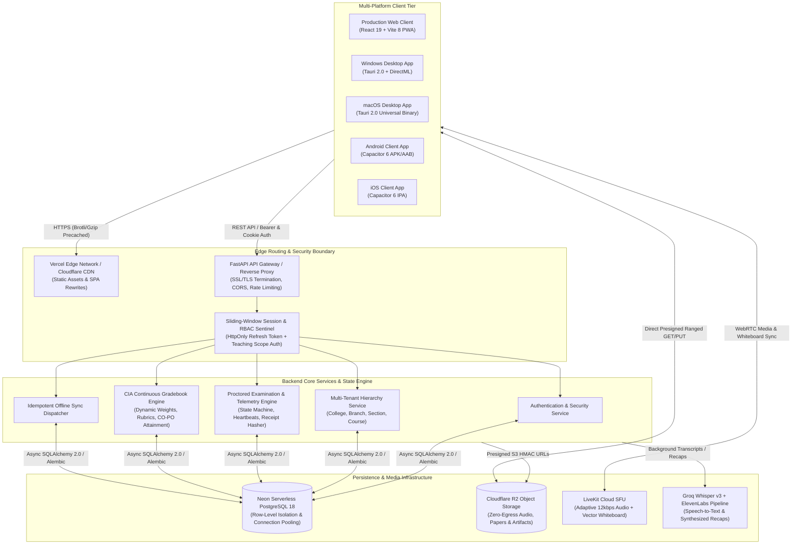
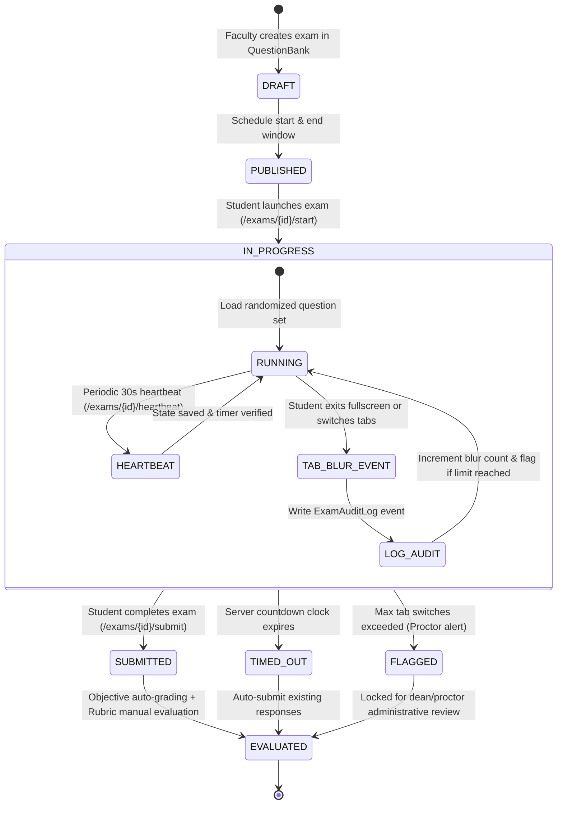

# 🏛️ LanternED Enterprise Architecture & System Specifications

> **Production-grade multi-tenant educational architecture designed for high availability, zero role leakage, low-bandwidth resilience, and cryptographically verified examination governance.**

---

## 1. High-Level System Architecture & Ingress Flow

LanternED operates on a decoupled client-server architecture engineered to support low-end mobile devices, legacy desktop hardware, and high-performance web browsers while imposing near-zero cloud egress costs.



---

## 2. Multi-Tenancy & Structural Hierarchy

LanternED enforces strict multi-tenancy at the relational schema layer to prevent any institutional data leakage between independent universities or schools.

### 2.1. Structural Model (Decoupled Entity Hierarchy)
1. **Colleges / Institutions (`colleges`):** Autonomous tenant units isolated by unique system identifiers and cryptographic verification codes (`EV-XXXX-XXXX`).
2. **Branches / Departments (`branches`):** Academic divisions (e.g., *Computer Science & Engineering*, *Mechanical Engineering*, *Sciences*) scoped strictly to their parent college.
3. **Sections (`sections`):** Cohort groups (e.g., *Section A*, *Section B*, *Batch 2026*) within a specific branch.
4. **Courses (`courses`):** Syllabi and learning paths attached directly to a branch:
   - **Decoupled Faculty Assignment:** A course can be created, configured, and mapped to syllabus outcomes without mandating an immediate faculty instructor. Teachers and sections are associated dynamically.
   - **Independent Section Allocations:** Multiple sections can enroll into a shared course while maintaining independent gradebook distributions and exam windows.

```
┌─────────────────────────────────────────────────────────────┐
│                       COLLEGE / CAMPUS                      │
│                  (Cryptographic Code: EV-*)                 │
└──────────────────────────────┬──────────────────────────────┘
                               │ 1:N
                               ▼
┌─────────────────────────────────────────────────────────────┐
│                    BRANCHES / DEPARTMENTS                   │
└──────────────┬───────────────────────────────┬──────────────┘
               │ 1:N                           │ 1:N
               ▼                               ▼
┌──────────────────────────────┐ ┌────────────────────────────┐
│      COHORT SECTIONS         │ │          COURSES           │
│   (e.g., Section A, B)       │ │  (Curriculum & Outcomes)   │
└──────────────┬───────────────┘ └─────────────┬──────────────┘
               │                               │
               └───────────────┬───────────────┘
                               │ N:M Dynamic Association
                               ▼
┌─────────────────────────────────────────────────────────────┐
│              COURSE SECTIONS & ENROLLMENTS                  │
│       • Decoupled Faculty Teaching Assignment               │
│       • Cohort Section Student Enrolments                   │
└─────────────────────────────────────────────────────────────┘
```

---

## 3. Sliding-Session Authentication & RBAC Isolation

To balance usability with institutional security standards, LanternED adopts a sliding-window token lifecycle that resolves premature logouts while neutralizing session hijacking.

### 3.1. Token Lifecycle Specification
- **Access Token:** Short-lived JWT (15-minute validity) stored in an `HttpOnly`, `Secure`, `SameSite=Lax/None` cookie named `lanterned_access_token`.
- **Refresh Token:** Cryptographically random 256-bit token with a sliding 12-hour window, stored in `lanterned_refresh_token` (`HttpOnly`, `Secure`).
- **Silent Refresh Interceptor:** Client API transports automatically request `/api/v1/auth/refresh` upon encountering a 401 response or when the access token approaches expiry, renewing both tokens seamlessly without UI interruption.
- **Inactivity Sentinel:** If no user input or API interactions occur for 30 consecutive minutes, an idle warning modal is rendered; failing user response terminates the session and purges local memory.
- **Second-Device Challenge:** Concurrent logins on different IPs/devices trigger a 6-digit OTP verification email via Resend (`notifications@mail.afzaltech.in`). Verification automatically revokes active sessions on all other devices.

### 3.2. Role-Based Access Control (RBAC) Matrix

| Portal Route | Allowed Persona | Scope Resolution Rule |
| :--- | :--- | :--- |
| `/super-admin/*` | `admin` | Global platform administration, college provisioning, high-level aggregated metrics, zero access from native application wrappers. |
| `/institution/*` | `teacher` (with `is_institution_admin=True`) | Scoped entirely to assigned `college_id`. Can manage branches, sections, approve students/teachers, and configure college settings. |
| `/teacher/*` | `teacher` | Scoped to courses, classes, assignments, and gradebooks explicitly mapped to the teacher's profile. |
| `/student/*` | `student` | Scoped to enrolled courses, assigned section cohorts, and individual exam attempts. |

---

## 4. Proctored Examination State Machine & Heartbeat Recovery

The examination engine is modeled as a resilient finite state machine capable of surviving catastrophic network drops and client reloads during high-stakes tests.



### 4.1. Auto-Save Heartbeat & Telemetry Protocol
1. **Client Execution Loop:**
   - Every 30 seconds, `StudentExamRunnerPage.tsx` dispatches a payload containing the current delta of responses to `/api/v1/exams/{id}/heartbeat`.
   - The server updates `exam_attempts.current_responses` (JSONB) and `exam_attempts.last_heartbeat_at`.
   - The response returns server-synchronized remaining duration in seconds, neutralizing client clock manipulation.
2. **Anti-Cheat Audit Trail:**
   - Client listeners capture `visibilitychange`, `blur`, and `fullscreenchange` events.
   - Each infraction dispatches an audit record containing `event_type`, `timestamp`, and `duration_ms`.
   - Once `tab_blur_count >= max_tab_switches`, the attempt is immediately marked `is_flagged_for_review = True`.
3. **Cryptographic Submission Receipt:**
   - On final submission, the server computes a SHA-256 HMAC digest:
     $$\text{Receipt} = \text{SHA256}(\text{attempt\_id} \parallel \text{student\_id} \parallel \text{final\_answers\_canonical\_json} \parallel \text{submitted\_at})$$
   - The resulting hash is stored in `exam_attempts.receipt_hash` and displayed to the student as an immutable proof-of-submission receipt.
