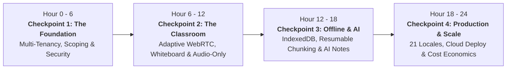
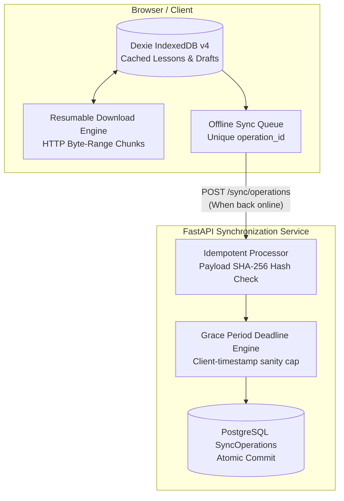

# 🏆 LanternED: 24-Hour Hackathon Jury Review & Pitch Guide
> **The Ultimate Checkpoint Companion: How to Pitch, Demo, and Defend LanternED Every 6 Hours**

---

## 📌 Executive Pitch & Elevator Pitch (Read Before Any Review)

> **"LanternED is an offline-first, low-bandwidth learning ecosystem engineered specifically for institutions where internet connectivity is intermittent, slow, or expensive. While traditional platforms like Zoom, Google Meet, and Canvas demand high-speed broadband and constant connectivity, LanternED enables live adaptive classes (cutting bandwidth by up to 90%), offline resumable downloads, offline assignment drafting with idempotent sync, and localized AI-generated study aids across 21 bundled languages."**

---

## 🕒 Hackathon Timeline at a Glance

---

# ⏱️ Hour 6 | Checkpoint 1: Foundation, Multi-Tenant Architecture & Security

### 🎯 Objective of this Sprint
Establish the institutional core: high-security multi-college hierarchy, administrative isolation, role-based teaching scopes, and session security on shared devices.

---

### 🔍 1. Current Real-World Problems Identified

1. **Enterprise Cost Barriers & Data Leaks:** Small or rural colleges cannot afford expensive LMS subscriptions ($5,000–$20,000/year). Most multi-tenant hackathon projects dump all schools into a single insecure database table where any teacher can see any student.
2. **Cybercafe / Shared Lab Computer Vulnerability:** In rural and tier-2/3 areas, students and teachers share public lab computers. If a user forgets to log out, their account remains exposed, or someone signs into the same account simultaneously from another terminal.
3. **Admin Privilege Escalation:** Conventional admin panels are either vulnerable to URL guessing or share regular session cookies that can be hijacked via cross-site attacks.

---

### 💡 2. The Engineering Solutions Built

* **Multi-College Hierarchy & Cryptographic Codes:** 
  The Platform Admin (`/super-admin`) creates institutions and generates unique, collision-resistant codes (`EV-XXXX-XXXX` from a 32-character alphabet omitting ambiguous characters). Registration strictly requires validating college, branch, section, and the active code before any user record is committed.
* **Strict Teaching Scope Enforcement (`teaching_scope_service.py`):**
  A teacher is bound to a section or an "All Sections" branch scope. The backend cryptographically validates on every request that teachers cannot create cohorts, access student submissions, or broadcast classes outside their authorized branch or section.
* **Dual-Session & Header Protection:**
  - `lanterned_admin_session` vs `lanterned_session`: completely isolated cookies.
  - Admin state-changing requests mandate the custom header `X-LanternED-Admin: 1`, nullifying CSRF attacks.
  - Admin sessions enforce single-session concurrency with an automatic idle timeout (120s).
* **Concurrent Login Protection & Mailbox OTP Verification:**
  Signing in on a second device while a session is active returns `202 Accepted {otp_required: true}` and dispatches a single-use 6-digit OTP to the user's verified email. Verifying the code invalidates the previous terminal session automatically.

---

### 🖥️ 3. Live Demo Flow (60–90 Seconds)

1. **Admin Console:** Navigate to `/super-admin`. Log in with admin credentials. Show the overview metrics (Colleges, Active Codes).
2. **Create Institution:** Click **New College**, name it (e.g. *"Rural Polytechnic Institute"*), generate the unique code `EV-XXXX-XXXX`, and add branches (e.g., *Computer Science* -> *Section A*).
3. **Registering under Constraint:** Open an incognito window at `/register/student`. Show dynamic fetching of active colleges and branches. Enter a wrong code -> rejected. Enter the correct code -> registered seamlessly.
4. **Scope Proof:** Log in as a teacher assigned to Section A. Show that attempting to address Section B or another college is refused at the API level.

---

### 🎙️ 4. Jury Pitch Script (What to Say)

> *"Good morning/afternoon, Judges! During the first 6 hours, we focused on building an unshakable, enterprise-ready foundation. Rural education cannot adopt a platform if it doesn't solve real governance and privacy problems.*
>
> *We tackled three major hurdles: First, we built a zero-trust multi-college hierarchy where each college has cryptographically unique codes (`EV-XXXX-XXXX`) and branch-level isolation. Second, we solved the shared cybercafe problem: if a student leaves their session open on a lab computer and signs in from home, our server flags the concurrent login, dispatches an OTP, and instantly revokes the stale session. Third, our administrative plane is completely isolated with dual-session tokens and strict CSRF protections. Everything you see is enforced directly in SQLAlchemy database constraints and FastAPI middleware."*

---

### ❓ 5. Anticipated Jury Questions & Winning Answers

| Question | Winning Answer |
|---|---|
| *"Why not just use Auth0 or Firebase Auth?"* | **Answer:** In resource-constrained environments, third-party auth services add external latency, paid tier caps, and lack native integration with our college-code validation, branch hierarchy, and dual-session invalidation policies. Our Argon2 + server-side session hash architecture gives zero-dependency security at $0 cost. |
| *"Can a teacher manipulate student data across branches?"* | **Answer:** No. Every course cohort, class token, and recording query runs through `teaching_scope_service.py`. The backend derives permissions from the authenticated server session, ignoring any client-supplied IDs. |

---

# ⏱️ Hour 12 | Checkpoint 2: Low-Bandwidth Real-Time Classroom & Interactive Tools

### 🎯 Objective of this Sprint
Deliver a live virtual classroom that functions reliably on 2G/3G connections where platforms like Zoom, Teams, and Google Meet disconnect or stutter.

---

### 🔍 1. Current Real-World Problems Identified

1. **Bandwidth Hogging by Mainstream SFUs:** Zoom and Google Meet consume 1.5 to 3.0 Mbps. A student in a rural area or on a capped prepaid mobile data plan runs out of data within 20 minutes, or experiences constant buffering.
2. **Whiteboard & Screen Sharing Bandwidth Penalty:** Streaming a shared whiteboard as high-resolution video frames consumes 800+ kbps. If the connection falters, the video blurs and equations/code become unreadable.
3. **Connection Drops & Loss of State:** When a rural student’s connection temporarily disconnects (e.g., cell tower handoff or power drop), they miss everything drawn on the board while they were away.

---

### 💡 2. The Engineering Solutions Built

* **Low-Bandwidth WebRTC Tuning (`ClassroomPage.tsx`):**
  - LiveKit `adaptiveStream` and `dynacast` are explicitly forced **ON**, meaning the server only pushes the video resolution the receiving client can handle.
  - Audio codec preset locked to `AudioPresets.speech` (**24 kbps** Opus with DTX and RED), cutting audio bandwidth in half compared to standard music presets (48 kbps) with zero voice fidelity loss.
  - Video stream capped at 360p with downscaled simulcast layers (`h180`, `h360`).
* **One-Click Adaptive Audio-Only Mode:**
  Students can switch to Audio-Only with a single tap, unsubscribing from incoming video tracks. Bandwidth drops from ~400 kbps to **under 25 kbps**, allowing students to attend classes on 2G edge networks.
* **Vector Data-Channel Whiteboard (`Whiteboard.tsx`, `useWhiteboard.ts`):**
  Instead of sending a heavy video feed of the board, strokes and typed text are serialized into compact JSON packets sent over LiveKit WebRTC **data channels**. Bandwidth used: **under 300 bytes per stroke**.
* **Automatic State Re-hydration for Late Joiners:**
  When a student joins late or reconnects after a signal drop, the teacher’s client detects the new peer and automatically transmits the complete vector history, rendering the board instantly.
* **Low-Distraction Background Blur & Floating Video Window:**
  Runs client-side background blur via `@livekit/track-processors` in WebAssembly (WASM). Draggable, resizable floating video window ensures the teacher’s camera doesn't obstruct whiteboard or shared screens.
* **Text Fallback & Web Speech Read-Aloud:**
  If the network degrades below voice threshold, students can switch to real-time text announcements with integrated browser-native SpeechSynthesis read-aloud.

---

### 🖥️ 3. Live Demo Flow (60–90 Seconds)

1. **Teacher Launches Class:** Teacher starts class in Section A. The LiveKit room initializes. Show the floating video window, drag it, resize it, and toggle background blur.
2. **Student Joins:** Open student browser. Notice instantaneous connection. Audio is crisp at 24 kbps.
3. **Whiteboard Demo:** Teacher opens whiteboard, draws a physics diagram and types formulas. Show the student's screen updating instantaneously with zero lag.
4. **Bandwidth Simulation & Late-Joiner Re-hydration:**
   - In browser DevTools, throttle the student’s network to "Slow 3G" and click "Audio Only". Video unsubscribes; audio remains uninterrupted.
   - Disconnect the student, draw new items on the teacher's board, reconnect the student: observe the whiteboard instantly re-hydrate the entire board!

---

### 🎙️ 4. Jury Pitch Script (What to Say)

> *"Judges, in this 12-hour review, we tackled the hardest barrier in online learning: bandwidth inequality. 
>
> If you test Zoom or Google Meet on a rural 3G connection, the video freezes and the call drops. We re-engineered the live classroom from the transport layer up. We tuned our LiveKit SFU with dynacast and an Opus speech profile running at just 24 kbps. 
> 
> Furthermore, instead of streaming the teacher's whiteboard as a heavy video feed that burns megabytes and blurs on slow connections, we built a vector data-channel whiteboard. Each stroke is transmitted as coordinate deltas taking fewer than 300 bytes. When a student's connection drops and reconnects, our protocol re-hydrates the entire canvas state automatically. Even on a 2G connection, students never miss a single note."*

---

### ❓ 5. Anticipated Jury Questions & Winning Answers

| Question | Winning Answer |
|---|---|
| *"What if a student abuses the whiteboard or data channel?"* | **Answer:** Room tokens are strictly role-scoped. Students are granted subscribe-only privileges. They cannot publish data packets or tracks unless the teacher explicitly invokes the `grant-mic` action. Whiteboard updates from non-teacher participants are discarded by clients. |
| *"Why not just use WebSockets for the whiteboard?"* | **Answer:** WebSockets run over TCP, which suffers from head-of-line blocking under packet loss—terrible for weak rural cellular connections. LiveKit data channels leverage SCTP over WebRTC UDP, providing ultra-low latency and resilience to packet drops. |

---

# ⏱️ Hour 18 | Checkpoint 3: Offline-First Architecture, Resumable Chunking & AI Notes

### 🎯 Objective of this Sprint
Empower students to continue studying, watching lectures, and submitting assignments even when completely disconnected from the internet, coupled with an AI synthesis engine.

---

### 🔍 1. Current Real-World Problems Identified

1. **The "No Internet Dinosaur" Dead End:** Traditional web apps fail completely the moment Wi-Fi or mobile data disconnects.
2. **Failed Lecture Downloads on Flaky Links:** A student downloading a 150 MB lecture recording gets to 90%, the signal drops, and the browser forces them to restart from 0 MB, burning limited data plans.
3. **Assignment Submission Disasters:** A student finishes homework offline on the bus, but by the time they reach Wi-Fi, the deadline has passed or their draft was lost on browser refresh.
4. **Listening to 60-Minute Recordings on Limited Bandwidth:** Reviewing past classes requires streaming gigabytes of video.

---

### 💡 2. The Engineering Solutions Built

* **Dexie.js (IndexedDB v4) Storage Engine (`db/db.ts`):**
  Locally caches lesson metadata, summaries, full recording blobs, assignment drafts, download chunk progress, and media playback positions.
* **Resumable Chunked Download Engine (`downloadEngine.ts`):**
  Downloads media using HTTP `Range: bytes=X-Y` requests. If connectivity breaks at 87%, it saves the completed chunks to IndexedDB. Once reconnected, it resumes at byte 87% without wasting a single byte. The assembled blob is verified against an SHA-256 checksum.
* **Idempotent Atomic Sync (`synchronization_service.py`):**
  - Offline assignment drafts generate a client-side UUID `operation_id`.
  - Upon reconnection, `POST /api/v1/sync/operations` submits the queue.
  - The backend commits the assignment and records the `operation_id` in a single database transaction.
  - Replaying the same request returns the cached result without duplicate writes. Tampered payloads with reused IDs trigger a `409 Conflict`.
  - **Deadline Grace Policy:** If a student finished work offline before the deadline, LanternED honors the submission within a configurable grace window (`OFFLINE_SUBMISSION_GRACE_HOURS = 24`), capping future device timestamps to server time to prevent clock tampering.
* **Whisper Turbo + LLM Lecture Notes Pipeline (`transcription_service.py`, `summary_service.py`):**
  - Recordings in Cloudflare R2 are processed via FFmpeg into speech-optimized audio.
  - Split into chunks to respect Whisper's 25 MB limit, maintaining per-chunk resumption state (`chunk_state`) so retries don't start from scratch.
  - Groq LLM generates key takeaways, topics, and flashcards.
  - Teachers review and approve before publication.
  - Students can download study notes as **DOCX (Word)** or **PDF** offline in their browser!

---

### 🖥️ 3. Live Demo Flow (90 Seconds)

1. **Go Offline:** In the browser, navigate to an assignment. Turn on **Airplane Mode** (or DevTools "Offline"). An ambient amber offline indicator appears.
2. **Draft & Save Offline:** Write the assignment answer. Attach offline notes. Click Save. Show IndexedDB persisting the draft under `assignmentDrafts`.
3. **Resumable Download:** Trigger download of a recorded class. Cut the network at 50%. Reconnect. Show the engine picking up from 50% and completing with verified SHA-256 checksum.
4. **Automatic Idempotent Sync:** Reconnect the internet. The sync manager fires in the background. The assignment is submitted atomically, status turns to "Submitted", and the grace period badge verifies the offline submission timestamp!
5. **AI Summary & Export:** Open a completed class. Show the AI summary, flashcards, and click "Export DOCX" to show instant client-side Word document generation.

---

### 🎙️ 4. Jury Pitch Script (What to Say)

> *"Judges, in this 18-hour sprint, we delivered true offline-first capability. Most edtech apps are useless without an active internet connection. With LanternED, students can study, watch classes, and write assignments with zero connectivity.
>
> When a student downloads a lecture on a patchy cellular network, our chunked download engine uses HTTP byte-range requests. If the connection drops at 90%, it doesn't fail; it pauses and resumes at the exact byte when the connection returns, saving precious mobile data.
>
> When writing assignments offline, drafts are queued in IndexedDB. Once back online, our idempotent synchronization service submits them with atomic guarantees and a 24-hour offline deadline grace period. Finally, we turned live recordings into high-yield study assets: our background worker extracts audio with FFmpeg, transcribes with Whisper, and synthesizes structured revision notes and flashcards that export to Word and PDF completely in-browser."*

---

### ❓ 5. Anticipated Jury Questions & Winning Answers

| Question | Winning Answer |
|---|---|
| *"Can a student manipulate their computer clock to submit an assignment past the deadline?"* | **Answer:** We thought of that. In `synchronization_service.py`, `_effective_submission_time()` checks `min(client_updated_at, utcnow())`. A forward-dated device clock gains nothing. If the submission arrives after the deadline + grace period, the server overrides the timestamp with current server time. |
| *"What happens to offline downloads on a shared public computer?"* | **Answer:** LanternED includes a Shared Device mode. When a user logs out, `db.clearPrivateUserData({ includeDownloads: true })` runs an IndexedDB transaction wiping all drafts, cached summaries, and downloaded media blobs so the next user cannot access them. |

---

# ⏱️ Hour 24 | Checkpoint 4: Production Deployment, 21 Languages, Security Audit & Scalability

### 🎯 Objective of this Sprint
Demonstrate production readiness, multilingual inclusivity (21 bundled locales + RTL), bulletproof security verification, and real-world cost economics.

---

### 🔍 1. Current Real-World Problems Identified

1. **The "Localhost Toy" Syndrome:** Most hackathon projects only work on `localhost:3000` with mock data and crash when exposed to real internet environments.
2. **The Language Divide:** In India, Southeast Asia, and Africa, millions of students cannot learn effectively in English. Yet fetching translation files over the network on a slow connection causes layout shifts and high data consumption.
3. **Skyrocketing Cloud Costs:** Live video platforms often incur massive bills ($5,000+/mo), making free educational initiatives unsustainable.

---

### 💡 2. The Engineering Solutions Built

* **21 Zero-Network Bundled Locales (`frontend/src/i18n/`):**
  - Pre-bundled JSON dictionaries inside the frontend build. Switching languages costs **0 bytes of network transfer**.
  - **Languages covered:** English, Hindi, Mandarin, Arabic, Bengali, Portuguese, Russian, Urdu, Indonesian, Swahili, Japanese, plus 10 Indian regional languages (Telugu, Tamil, Marathi, Gujarati, Kannada, Odia, Malayalam, Punjabi, Assamese, Maithili).
  - Native Right-to-Left (RTL) styling for Arabic and Urdu.
* **Production Cloud Deployment:**
  - **Frontend:** Vercel CDN with SPA rewrites (`vercel.json`) and Workbox PWA caching.
  - **Backend:** Docker container on Render with automated Alembic migrations (`render.yaml`).
  - **Database:** Neon Serverless PostgreSQL 18 with 38 relational tables.
  - **Media & Egress:** Cloudflare R2 (S3 API) providing **$0 egress fees**, saving thousands in bandwidth bills.
  - **Live Streaming:** LiveKit Cloud SFU.
* **Security Hardening (`security-audit-skill`):**
  - Integrated security audit skill covering 15 threat vectors: parameter injection, session hijacking, cross-tenant isolation, and rate-limiting buckets.
  - Parameterized queries across 100% of database access via SQLAlchemy 2.0.
  - Strict Origin check middleware and CORS headers restricting API consumption to the frontend origin.
* **Empirical Cost Model ([`docs/cost_model.py`](file:///c:/Users/Nandhi%20vardhan%20reddy/Desktop/LanternED/docs/cost_model.py)):**
  Mathematical model showing a 1,000-student institution costs just **$174/month (₹16,749)** by utilizing Cloudflare R2 zero-egress storage and optimized 24 kbps audio.

---

### 🖥️ 3. Live Demo Flow (90 Seconds)

1. **Live Production URLs:** Open the deployed app on Vercel (`https://lanterned.vercel.app`) talking to the live Render API (`https://lanterned-api.onrender.com/health`).
2. **Zero-Latency Language Switching:** Click the language switcher in the navbar. Switch to **Hindi**, then **Telugu**, then **Arabic**. Note that Arabic automatically flips layout to Right-to-Left (RTL). Inspect DevTools Network tab: **0 network requests made!**
3. **PWA Installability:** Show Chrome install prompt ("Install LanternED as App").
4. **Cost Model & Economics:** Open `docs/cost_model.py` simulation results showing low cost per student.

---

### 🎙️ 4. Jury Pitch Script (What to Say)

> *"Judges, in this final 24-hour review, we present LanternED not as a prototype, but as a production-grade, globally accessible product.
>
> First, education in developing nations must be in the student's mother tongue. We bundled 21 distinct languages—including 11 Indian languages, Swahili, Arabic, and Indonesian—directly into the application shell. Switching languages makes zero network requests, saving every kilobyte. For Arabic and Urdu, the layout shifts to Right-to-Left automatically.
>
> Second, our production deployment is live right now: static PWA on Vercel, containerized backend on Render, PostgreSQL on Neon, and video egress into Cloudflare R2.
>
> Third, sustainability: through our cost model, we proved that by eliminating S3 egress fees with Cloudflare R2 and halving audio bitrates, a 1,000-student rural college can run LanternED for just $174 a month—less than 18 cents per student. LanternED is secure, tested across 450+ backend tests and 220+ frontend tests, and ready for deployment on Day One."*

---

### ❓ 5. Anticipated Jury Questions & Winning Answers

| Question | Winning Answer |
|---|---|
| *"How will you monetize or keep this sustainable for colleges that have no budget?"* | **Answer:** LanternED supports hybrid hosting. A college can run on our shared cloud tier for ~$0.17/student/month, or use our open-source Docker Compose self-hosting package (`deploy/self-hosted/`) on an on-premise refurbished server with local MinIO storage for $0 monthly cloud costs. |
| *"Have you tested the application against real network drops and concurrency?"* | **Answer:** Yes. We built an automated test harness with Playwright (`playwright.offline.config.ts`, `playwright.real.config.ts`), a capacity load testing kit (`ops/loadtest/classday.js`), and a suite of 450+ unit and integration tests verifying offline download assembly, atomic sync, and scope enforcement. |

---

## 📊 Summary Scorecard for Judges

| Evaluation Criteria | How LanternED Delivers Maximum Points |
|---|---|
| **Technical Complexity** | Custom LiveKit WebRTC tuning (24kbps Opus), vector data-channel whiteboard with re-hydration, Dexie.js IndexedDB v4 caching, HTTP byte-range resumable chunking with SHA-256 validation, and idempotent atomic offline sync. |
| **Real-World Impact** | Democratizes education for millions of rural and tier-2/3 students affected by weak internet, power outages, expensive data caps, and shared devices. |
| **Execution Quality** | Clean full-stack codebase (FastAPI + React 19 + TypeScript + Tailwind v4 + PostgreSQL), 38 database tables, 450+ automated tests, live production deployment on Vercel & Render. |
| **Inclusivity & UX** | 21 pre-bundled zero-network locales, native RTL support, offline PWA installation, and shared-device privacy controls. |
| **Viability & Scale** | Validated cost model ($174/mo per 1,000 students), zero-egress Cloudflare R2 storage architecture, and automated self-hosting Docker Compose suite. |

---
*Created for the LanternED Hackathon Defense Team.*
